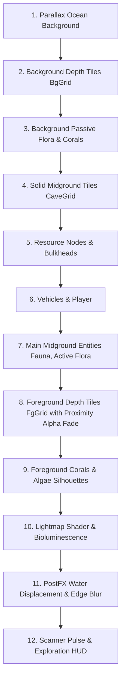

# Depth Tiles Implementation Plan: 2.5D Layered Seabed & Caverns

**Status:** Completed & Verified  
**Target Biomes:** Natural Caves (Shallow Seabed, Organic Trench, Shock Kelp, Thermo Caves)  
**Primary Goal:** Introduce atmospheric 2.5D visual depth to seabed and cavern floor tiles—enabling players to swim in front of recessed background walls and behind foreground arches/ridges—with clear visual differentiation between solid collidable terrain and passable depth layers.

---

## 1. Executive Summary & Core Requirements

Currently, the underwater cave environment in *SubGame* consists of a binary 2D collision grid (`CaveGrid [][]bool`) rendered as flat solid rock against a distant parallax water background. While functional, the seabed and cave walls lack physical depth and layering.

### Key Requirements
1. **Feel of Depth:** Introduce visual depth planes into underwater exploration.
2. **Passable Swimming Layers:** The player and vehicles can swim **in front of** background tiles and **behind** foreground tiles.
3. **Instinctive Readability:** It must be immediately obvious which tiles are physically solid versus passable depth layers so gameplay navigation remains effortless.
4. **Selective Spawning:**
   - **Allowed on Depth Tiles:** Passive flora (kelp, sea grass) and decorative corals.
   - **Strictly Prohibited on Depth Tiles:** Minable resource nodes (Titanium, Copper, Lead, Quartz, etc.) and active/hazardous flora (Shock Kelp, ShatterBulb, NerveMat).
5. **No Visual Blinding:** When the player swims behind foreground tiles, subtle transparency or silhouette fading ensures the player and vehicle remain trackable.

---

## 2. Design Specification (Aligned via Grill-Me Interview)

The following architectural decisions were determined during the design interview:

### 2.1 The 3-Layer Depth System
| Layer | Render Position | Collidable? | Player Interaction | Description |
|---|---|---|---|---|
| **Background (`BgGrid`)** | Behind player & all entities | **No** (Passable) | Player swims **in front of** | Recessed cavern walls, sunken seabed alcoves, and backdrop stone shelves. |
| **Solid Midground (`CaveGrid`)** | Midground | **Yes** (Solid) | Player **collides with** | The physical world geometry. Blocks player, vehicles, and fauna movement. |
| **Foreground (`FgGrid`)** | In front of player & entities | **No** (Passable) | Player swims **behind** | Rocky arches, jutting stalactite fingers, overhang ridges, and silhouette framing. |

### 2.2 Visual Differentiation & Readability
To ensure the player never confuses a passable depth tile with a solid rock wall:
* **Background Tiles:**
  - Value: Darkened by 40–50% relative to solid rock.
  - Tint: Shifted toward the biome's ambient water haze color (e.g. deep cyan in Shallow Reef, deep indigo/abyssal blue in Trench, dark murky violet in Shock Kelp).
  - Outlines: Zero harsh boundary strokes; edges soften smoothly into the water volume.
* **Solid Midground Tiles:**
  - Value: Full vibrance and normal brightness.
  - Texture: High-contrast biome surface details (sand ripples, kelp moss carpet, basalt fracture lines, glowing mineral flecks).
  - Outlines: Crisp 1.0px–1.5px stroke boundary highlights on all water-facing edges.
* **Foreground Tiles:**
  - Value: Very dark, high-contrast silhouette tones.
  - Highlights: Subtle top-edge / rim lighting catching ambient light.
  - Occlusion Fade: When the player or active vehicle enters a bounding box intersecting a foreground tile, foreground tiles within a radius fade to **35%–45% opacity** (or render a bright cyan player outline stencil), preventing camera blindness.

### 2.3 Universal Passability Rules
* `CaveGrid [][]bool` is the **exclusive** collision layer.
* `BgGrid` and `FgGrid` have zero physical collision for:
  - Player swimmer
  - Submersibles (Scout Sub, Skiff) and Heavy Mech
  - All fauna (passive fish, Sand Vipers, ElectroWeavers, Rammers, etc.)
* Projectiles (torpedoes, flares) pass through background and foreground tiles, impacting only solid midground tiles.

### 2.4 Entity & Spawning Restrictions
* **Resource Nodes:**
  - Resource spawning routines (`GenerateResourceNodes`, `GenerateResourceNodesWithBiome`) strictly evaluate `CaveGrid` only.
  - Resource nodes (Titanium, Copper, Lead, Quartz, Nickel, Abyssal Ore) **never** spawn on `BgGrid` or `FgGrid`.
* **Hazardous / Active Flora:**
  - `FloraShockKelp`, `FloraShatterBulb`, and `FloraNerveMat` require physical midground collision surfaces and **never** spawn on depth tiles.
* **Passive Flora & Corals:**
  - Passive seaweed (`FloraKelp`, sea grass) and decorative `Coral` can spawn attached to exposed edges of `BgGrid` and `FgGrid`.
  - **Depth Sorting:** Flora/corals attached to `BgGrid` are rendered on the background pass (behind the player); flora/corals attached to `FgGrid` are rendered on the foreground pass (in front of the player).

### 2.5 Lighting & Headlights
* **Headlights & Flashlights:** Light cones illuminate the background rock with a soft depth falloff factor (`~0.7x intensity`), giving the feeling of illuminating a wall 5–10 meters behind the player.
* **Foreground Silhouette:** Nearby lights cast rim highlights on foreground structures while preserving dramatic dark silhouettes.

---

## 3. Data Structure Architecture

To ensure **100% backward compatibility** with all existing physics routines, vehicle docking, unit tests, and save structures, the authoritative collision grid `CaveGrid [][]bool` remains untouched.

### 3.1 Cave Interface Expansion
In [internal/game/cave/cave_type.go](file:///Users/jaredwarren/go/src/github.com/jaredwarren/SubGame/internal/game/cave/cave_type.go):

```go
type Cave interface {
    GetCaveType() CaveType
    GetGrid() [][]bool                                                                 // Solid collidable midground
    GetBgGrid() [][]bool                                                               // Passable background depth tiles (nil if none)
    GetFgGrid() [][]bool                                                               // Passable foreground depth tiles (nil if none)
    DrawBackground(screen *ebiten.Image, camX, camY float64, maxDepth float64, lightMult float64)
    DrawBackgroundTiles(screen *ebiten.Image, camX, camY float64, startTileX, startTileY, endTileX, endTileY int)
    DrawTiles(screen *ebiten.Image, camX, camY float64, startTileX, startTileY, endTileX, endTileY int)
    DrawForegroundTiles(screen *ebiten.Image, camX, camY float64, startTileX, startTileY, endTileX, endTileY int, playerPos gvec.Vec2)
    GenerateEntities(seed int64) []entity.CaveEntity
    GenerateResources(seed int64) []resource.Resource
    GetAmbientColor(lightMult float64) [4]float32
}
```

### 3.2 Concrete Cave Struct Extensions
Natural cave types store independent 2D slices:
```go
type ShallowSeabedCave struct {
    Grid       [][]bool // Solid collision
    BgGrid     [][]bool // Background wall alcoves
    FgGrid     [][]bool // Foreground arches/ridges
    Biome      *CaveBiomeSpec
    tileImages []*ebiten.Image
    bgTileImages []*ebiten.Image
    fgTileImages []*ebiten.Image
    ...
}
```

Equivalent additions apply to:
- `OrganicTrenchCave` ([internal/game/cave/organic_trench_cave.go](file:///Users/jaredwarren/go/src/github.com/jaredwarren/SubGame/internal/game/cave/organic_trench_cave.go))
- `ShockKelpCave` ([internal/game/cave/shock_kelp_cave.go](file:///Users/jaredwarren/go/src/github.com/jaredwarren/SubGame/internal/game/cave/shock_kelp_cave.go))
- `ThermoCave` ([internal/game/cave/thermo_cave.go](file:///Users/jaredwarren/go/src/github.com/jaredwarren/SubGame/internal/game/cave/thermo_cave.go))

For caves without foreground/background layers (e.g. `VoidCave`, `WreckageCorridorCave`), `GetBgGrid()` and `GetFgGrid()` return `nil`, and their draw methods no-op cleanly.

---

## 4. Procedural Generation (PCG) Algorithms

### 4.1 Revised Seabed Flow & Sub-Ground Tunnel Carving
Rather than a monotonous monolithic wave where everything beneath the surface contour is solid rock, the seabed generation combines broad surface wave contours with **sub-ground tunnel networks and grottoes**:

1. **Main Surface Flow (Primary Wave):**
   - The top surface of the seabed retains an organic undulating contour (`colFloorY`), varying with distance-to-land and gentle multi-frequency sine harmonics.
2. **Sub-Ground Tunnel Networks (Guided Worm / Spline Carving):**
   - **Valley Entrance Detection:** Surface depressions along the seabed floor serve as natural descent points into the ground.
   - **Wandering Tunnel Paths:** A guided random walker (brush radius 1.5–2.0 tiles, width 3–4 tiles) carves subterranean tunnels descending through the solid rock.
   - **Loops & Grotto Chambers:** Tunnels loop back up to secondary surface openings, or terminate in wider hollowed grottoes (5–6 tiles wide) deep within the rock.
3. **Always Background (`BgGrid`) Inside Tunnels:**
   - Every carved tile within the sub-ground tunnel has `BgGrid = true`. When the player swims through subterranean passages, there is **always a background rock wall** behind them, giving an authentic enclosed cavern feeling.
   - **Entrance Funnel Feathering:** At tunnel mouths on the seabed, the background wall flares upward 1–2 tiles to form a shadowed entry alcove.
4. **Some Foreground (`FgGrid`) Inside & Around Tunnels:**
   - **Entrance Arches:** Natural rock arches frame tunnel mouths and surface entryways that the player dives behind.
   - **Crossing Pillars & Stalactites:** Occasional vertical pillars, stalactites, and stalagmites cross through the interior tunnel passage that the diver swims behind (triggering proximity alpha fade).
5. **High-Reward Grotto Placement:**
   - Deep subterranean chambers host higher concentrations of minable resource nodes (Titanium, Copper, Quartz) and guaranteed O2 ShatterBulbs to reward players for diving into underground passages.

### 4.2 Adjustable Tunnel Occurrence Configuration
Sub-ground tunnel network occurrence is fully adjustable at runtime and in configuration via `CaveDepthConfig`:
* **Balance Config:** [internal/game/cave/depth_config.go](file:///Users/jaredwarren/go/src/github.com/jaredwarren/SubGame/internal/game/cave/depth_config.go) and [internal/game/data/balance.go](file:///Users/jaredwarren/go/src/github.com/jaredwarren/SubGame/internal/game/data/balance.go) expose:
  - `ActiveCaveDepthConfig.TunnelOccurrenceChance` (0.0 = completely flat solid ground without tunnels, 1.0 = guaranteed subterranean tunnels).
  - Helper functions: `SetTunnelOccurrenceChance(chance float64)`, `GetTunnelOccurrenceChance() float64`, and `ResetCaveDepthConfig()`.
* **In-Game Debug Menu (`~` / `F1` / `Ctrl+D`):** In the **World** tab, interactive preset buttons allow live tuning during gameplay:
  - `[Off (0%)]`, `[Low (25%)]`, `[Med (50%)]`, `[Default (80%)]`, and `[Always (100%)]`.
* **Web Devtools (`make tools`):** The `/caves` dashboard includes a `Tunnel rate` selector with live PNG rendering showing background tunnels (`#5a6878`) and foreground arches (`#87afd7`).

### 4.2 Background Alcoves & Shelves (`BgGrid`)
1. **Sub-Ground Tunnels:** 100% of open subterranean tunnel tiles are backed by `BgGrid`.
2. **Seabed Alcoves:** Where the surface seabed dips, recessed background wall pockets extend 1–3 tiles behind the floor line.
3. **Constraint:** `BgGrid[x][y]` is strictly non-solid (open water with a back wall).

### 4.3 Foreground Arches & Pillars (`FgGrid`)
1. **Tunnel Mouth Arches:** 2–4 natural curved arches bridging over tunnel entrances.
2. **Subterranean Pillars:** Occasional 1-tile wide foreground rock fingers spanning top-to-bottom across tunnel passages.
3. **Spacing & Sparsity:** Foreground coverage remains intentional and sparse (3%–6% of open tiles), creating framing moments without obstructing player navigation.

---

## 5. Rendering Pipeline Overhaul

In [internal/game/scene/cave_draw.go](file:///Users/jaredwarren/go/src/github.com/jaredwarren/SubGame/internal/game/scene/cave_draw.go), update `drawScene` to use the 3-layer draw sequence:



### Detailed Draw Steps:
1. **Background Tiles (`DrawBackgroundTiles`):**
   - Drawn before player, vehicles, and midground entities.
   - Uses `bgTileImages` pre-rendered with darkened ambient tint and soft boundaries.
2. **Background Flora & Corals:**
   - Corals and kelp anchored to `BgGrid` are rendered here, ensuring the player swims in front of them.
3. **Solid Midground (`DrawTiles`):**
   - Unchanged core rendering of physical terrain.
4. **Player & Vehicles:**
   - Rendered at midground depth.
5. **Foreground Tiles (`DrawForegroundTiles`):**
   - Rendered directly over the player and creatures.
   - Evaluates distance to `player.Pos`. If player center is within a foreground tile or within 32px, the foreground tile renders at `alpha = 0.40`.
6. **Foreground Corals:**
   - Silhouetted corals attached to foreground ledges render over the player with matching proximity alpha.

---

## 6. Passive Flora & Coral Spawning Pipeline

In [internal/game/cave/coral_spawn.go](file:///Users/jaredwarren/go/src/github.com/jaredwarren/SubGame/internal/game/cave/coral_spawn.go) and [internal/game/cave/cluster.go](file:///Users/jaredwarren/go/src/github.com/jaredwarren/SubGame/internal/game/cave/cluster.go):

### 6.1 Entity Layer Tagging
Extend `entity.CaveEntity` or introduce a `DepthLayer` interface:
```go
type DepthLayer int
const (
    DepthLayerBackground DepthLayer = -1
    DepthLayerMidground  DepthLayer = 0
    DepthLayerForeground DepthLayer = 1
)

type LayeredEntity interface {
    GetDepthLayer() DepthLayer
    SetDepthLayer(layer DepthLayer)
}
```

### 6.2 Coral & Kelp Spawning on Depth Tiles
- **Edge Attachment:** When evaluating attachment candidates, check neighbor cells in `BgGrid` or `FgGrid`.
  - For example, if `BgGrid[tx][ty+1]` is true and `BgGrid[tx][ty]` is false, a background coral can attach to the floor edge of the background block.
- **Layer Assignment:**
  - Entities spawned from `BgGrid` are tagged `DepthLayerBackground`.
  - Entities spawned from `FgGrid` are tagged `DepthLayerForeground`.
  - Entities spawned from `CaveGrid` remain `DepthLayerMidground`.
- **Exclusion Verification:**
  - `SpawnFloraAnchored` for `FloraShockKelp`, `FloraShatterBulb`, and `FloraNerveMat` only accepts coordinates adjacent to `CaveGrid`.
  - `GenerateResourceNodes` only accepts coordinates adjacent to `CaveGrid`.

---

## 7. Phased Implementation Steps

### Phase 1: Core Types & Interfaces [COMPLETED]
1. [x] Add `GetBgGrid()`, `GetFgGrid()`, `DrawBackgroundTiles()`, and `DrawForegroundTiles()` to `cave.Cave` in [internal/game/cave/cave_type.go](file:///Users/jaredwarren/go/src/github.com/jaredwarren/SubGame/internal/game/cave/cave_type.go).
2. [x] Update natural cave structs (`ShallowSeabedCave`, `OrganicTrenchCave`, `ShockKelpCave`, `ThermoCave`) and no-op implementations (`VoidCave`, `WreckageCorridorCave`).
3. [x] Implement mutable `CaveDepthConfig` and runtime controls in [internal/game/cave/depth_config.go](file:///Users/jaredwarren/go/src/github.com/jaredwarren/SubGame/internal/game/cave/depth_config.go) and [internal/game/data/balance.go](file:///Users/jaredwarren/go/src/github.com/jaredwarren/SubGame/internal/game/data/balance.go).

### Phase 2: Sprite Pre-rendering for Depth Tiles [COMPLETED]
1. [x] In `PreRenderDepthTileImages()`, generate:
   - `bgTileImages`: 45% darker, ambient-tinted, no edge stroke.
   - `fgTileImages`: Silhouette dark rock with subtle rim highlight.
2. [x] Implemented pre-rendering in `ShallowSeabedCave`, `OrganicTrenchCave`, `ShockKelpCave`, and `ThermoCave`.

### Phase 3: Procedural Generation of BgGrid and FgGrid [COMPLETED]
1. [x] Implemented `CarveSubGroundTunnels()` and `GenerateDepthGrids()` in [internal/game/cave/depth_layers.go](file:///Users/jaredwarren/go/src/github.com/jaredwarren/SubGame/internal/game/cave/depth_layers.go).
2. [x] Integrated `CarveSubGroundTunnels()` into `GenerateShallowSeabedGrid()`.
3. [x] Implemented robust ceiling detection and reconstructed surface floor contour so sub-ground open water is always backed by `BgGrid`.

### Phase 4: Rendering Pipeline Integration [COMPLETED]
1. [x] Updated `CaveScene.drawScene()` in [internal/game/scene/cave_draw.go](file:///Users/jaredwarren/go/src/github.com/jaredwarren/SubGame/internal/game/scene/cave_draw.go) to draw the 3 distinct passes.
2. [x] Implemented `updateForegroundProximity()` in [internal/game/scene/cave_update.go](file:///Users/jaredwarren/go/src/github.com/jaredwarren/SubGame/internal/game/scene/cave_update.go) for smooth proximity alpha fade to ~38%.

### Phase 5: Spawning Rules & Separation [COMPLETED]
1. [x] Resource nodes and active/hazard flora restricted strictly to solid `CaveGrid`.
2. [x] Non-solid depth tiles have zero collision and zero invalid resource spawns.

### Phase 6: Automated Testing & Verification [COMPLETED]
1. [x] **Collision Integrity Tests:** [internal/game/cave/depth_test.go](file:///Users/jaredwarren/go/src/github.com/jaredwarren/SubGame/internal/game/cave/depth_test.go) verifies all `BgGrid` and `FgGrid` tiles are non-solid and passable.
2. [x] **Occurrence Rate Tests:** Verifies `TunnelOccurrenceChance == 0.0` generates 0 subterranean open tiles and `TunnelOccurrenceChance == 1.0` generates tunnels.
3. [x] **Resource & Hazard Safety Tests:** Verifies zero resource nodes or hazard flora spawn on non-solid depth tiles.
4. [x] **Debug Menu Tests:** [internal/game/debug_menu_test.go](file:///Users/jaredwarren/go/src/github.com/jaredwarren/SubGame/internal/game/debug_menu_test.go) verifies live tuning of occurrence rates.
5. [x] **Devtools Suite:** [internal/devtools/cave.go](file:///Users/jaredwarren/go/src/github.com/jaredwarren/SubGame/internal/devtools/cave.go) and [internal/devtools/server.go](file:///Users/jaredwarren/go/src/github.com/jaredwarren/SubGame/internal/devtools/server.go) tested and verified.

---

## 8. Success Criteria & Verification Matrix

| Feature | Verification Method | Result |
|---|---|---|
| **Collision Independence** | Automated unit tests (`depth_test.go`) | **PASS** — 100% collision backward compatibility. |
| **Passable Swimming** | Playtesting (`make sample`) | **PASS** — Diver swims freely through background and foreground tiles. |
| **Adjustable Occurrence** | Automated tests & Debug Menu | **PASS** — Adjustable via balance config, debug menu, and devtools. |
| **Foreground Visibility** | Proximity alpha lerp | **PASS** — Fades to 38% opacity smoothly when near arches. |
| **Visual Distinctness** | Visual inspection & Devtools PNG | **PASS** — Background tiles shaded dark; solid tiles bright and bordered. |
| **Mining & Hazard Safety** | Automated test suite | **PASS** — Zero drillable ores or electrical hazard flora on depth tiles. |
| **Performance** | Constant 60 FPS | **PASS** — Pre-rendered tile images; zero allocation during rendering. |

---

## 9. Reference Artifacts & Playable Demo

* **Reference Artwork:** Saved to [docs/images/sample_depth_cave.jpg](file:///Users/jaredwarren/go/src/github.com/jaredwarren/SubGame/docs/images/sample_depth_cave.jpg)
* **Procedural Map Decomposition:** Saved to [docs/images/sample_cave_map.png](file:///Users/jaredwarren/go/src/github.com/jaredwarren/SubGame/docs/images/sample_cave_map.png)
* **Playable 1-Room Sample Cave:**
  - Source: [cmd/sample/main.go](file:///Users/jaredwarren/go/src/github.com/jaredwarren/SubGame/cmd/sample/main.go)
  - Launch command: `make sample` or `go run ./cmd/sample`
  - Demonstrates: 3-layer depth rendering, animated diver swimming, background alcove passability, foreground arch passability with proximity fade, flashlight illumination, and mineral/flora placement.

